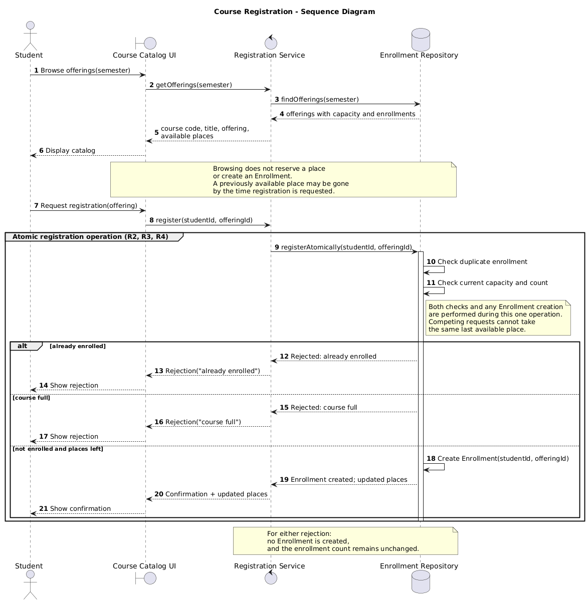
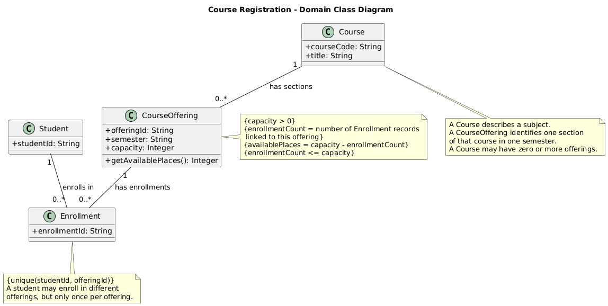
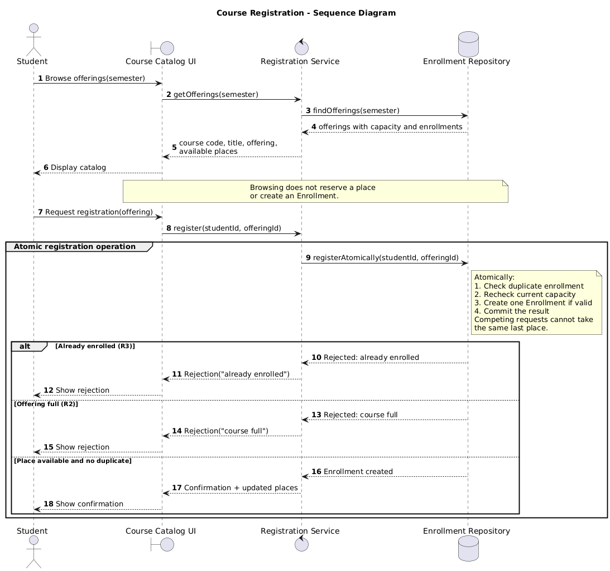
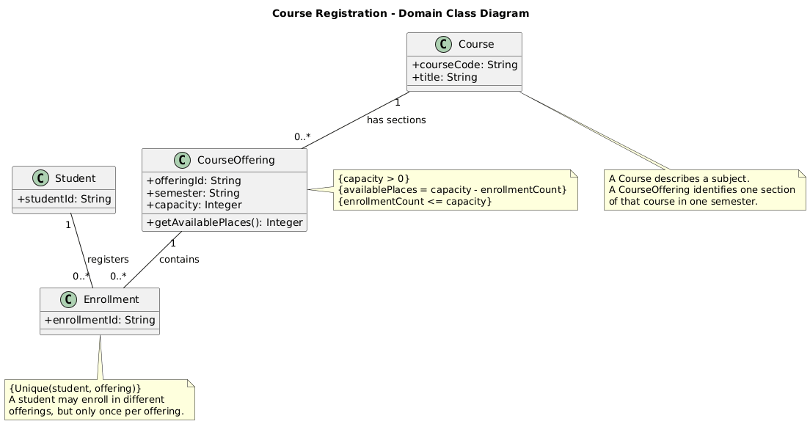

# SIS #02 — AI-Assisted UML Modeling: University Course Registration

<!--
  This is the only file you write your report in. README.md tells you what goes where.

  Rules the checker relies on:
  - Do not delete, rename or renumber the ## headings, the ### headings, or the **Label:** words.
  - Replace every "(write here)" and "(paste here)". None may be left when you submit.
  - Comments like this one are ignored by the checker and the word counter. Delete them or leave them.
-->

## 1. Scope and assumptions

<!-- Your FINAL scope statement and assumptions, after reviewing Prompt A's output. Say here
     what is out of scope (payments, prerequisites, timetable clashes, waiting lists,
     cancellation) — section 2 must not mention them. Section 10 keeps your first version. -->

**Scope:**This model covers browsing course offerings, registering students, and rejecting registration requests when an offering is full or the student is already registered, while excluding payments, prerequisites, scheduling clashes, waiting lists, and cancellation; browsing an offering does not reserve a place.
Assumptions

**Assumptions:**
1. Available places: Available places are calculated as the maximum capacity of an offering minus all existing Enrollment records for that offering, since cancellation is outside the model.
2. Student ID: Each student has a unique Student ID, which identifies the student when checking whether they are already enrolled in the same offering.
3. Multiple enrollments: A student can enroll in multiple different course offerings, but can have only one Enrollment per student per offering, in accordance with R3.

## 2. User stories and acceptance criteria

<!-- Your APPROVED requirements: Prompt A's draft after your review. Keep the IDs, the three
     story headings and the bullet shape. Every criterion names the rule(s) it maps to,
     e.g. (R2, R4). Two criteria per story. Nothing out of scope.
     Format of a criterion, on one bullet:
     - **AC-03** (R2, R4): Given ..., When ..., Then ... -->

### US-01 — Browse offerings

**US-01:**As a student, I want to browse course offerings for a semester so that I can see the course information and available places.

- **AC-01** (R1): Given a course offering exists for the selected semester, When the student browses the electronic course catalog, Then the system shows the course code, title, offering, and available places.
- **AC-02** (R1): Given a course offering has available places, When the student views the offering in the catalog, Then no Enrollment is created and the available places remain unchanged.

### US-02 — Register for an offering

**US-02:** As a student, I want to register for a course offering so that I can secure an available place in that offering.

- **AC-03** (R2, R3, R4): Given the selected offering has an available place and the student is not already enrolled in it, When the student requests registration, Then the system creates exactly one Enrollment, the places left decrease by one, and a confirmation is returned.
- **AC-04** (R2, R4, R5): Given two different students request registration for the last available place in the same offering at the same time, When the registration requests are processed, Then exactly one request creates an Enrollment and the other is rejected as "course full", so the enrollment count does not exceed the offering's capacity.

### US-03 — Receive a clear rejection

**US-03:** As a student, I want to receive a clear reason when my registration is rejected so that I understand why I cannot register.

- **AC-05** (R2, R5): Given the catalog showed an available place but the selected offering is now full, When the student requests registration, Then the system rejects the request, explains "course full", creates no Enrollment, and leaves the enrollment count unchanged.
- **AC-06** (R3, R5): Given the student is already enrolled in the selected offering, When the student requests registration again, Then the system rejects the request, explains "already enrolled", creates no Enrollment, and leaves the enrollment count unchanged.

## 3. Sequence diagram

<!-- The FINAL diagram, rendered. Change .png to .svg if that is what you exported. -->



**Participants:** The lifelines involved are the Student actor, **Course Catalog UI** (boundary), **Registration Service** (control), and **Enrollment Repository** (database).


**Atomic operation:** The atomic step is the single registerAtomically call (message 9) and everything the Enrollment Repository does inside it: the duplicate check (message 10), the current capacity and count check (message 11) and, in the success branch only, the creation of the Enrollment (message 18). These messages sit inside the group "Atomic registration operation (R2, R3, R4)" and the note beside the repository, so competing requests cannot take the same last place. A catalog view reserves nothing because browsing (messages 1 to 6) only reads offerings through findOfferings and creates no Enrollment, as the note says. The availability is checked again at registration time (messages 10 and 11), so a previously shown place may already be gone.

**Where the Enrollment is created:** In message 18, "Create Enrollment(studentId, offeringId)", a self-message on the Enrollment Repository lifeline, in the branch "not enrolled and places left". It produces an instance of the Enrollment class from section 4, linked to one Student and one CourseOffering. The confirmation (messages 19 to 21) comes only after it, and the two rejection branches contain no creation message.

**Technical lifelines:** Course Catalog UI, Registration Service and Enrollment Repository are not classes in the class diagram. They show who does the work at run time, while the class diagram shows the domain concepts Student, Course, CourseOffering and Enrollment and their constraints. The difference in abstraction is fine because the two diagrams answer different questions: the sequence diagram shows behavior and order, and the class diagram shows structure. The Student actor corresponds to the Student class.

## 4. Class diagram

<!-- The FINAL diagram, rendered. -->



<!-- One row per association in classes.puml, read in both directions. -->

| Association | Read left to right | Read right to left |
| --- | --- | --- |
| Course "1" -- "0..*" CourseOffering : has sections | One Course has zero or more CourseOfferings (sections). | Each CourseOffering belongs to exactly one Course. |
| Student "1" -- "0..*" Enrollment : enrolls in | One Student has zero or more Enrollments. | Each Enrollment belongs to exactly one Student. |
| CourseOffering "1" -- "0..*" Enrollment : has enrollments | One CourseOffering has zero or more Enrollments. | Each Enrollment refers to exactly one CourseOffering. |


**How an Enrollment links a student to an offering:** An Enrollment sits between Student and CourseOffering. It has exactly one Student, through the "enrolls in" association, and exactly one CourseOffering, through the "has enrollments" association. One Enrollment record is therefore one student registered in one specific offering, not in the general Course. A student reaches the offerings they are registered in through their Enrollments, and an offering reaches its registered students the same way.


**Capacity constraint:** CourseOffering has a capacity, and the constraints in its note say that capacity is greater than 0, that enrollmentCount is the number of Enrollment records linked to the offering, that availablePlaces equals capacity minus enrollmentCount, and that enrollmentCount never exceeds capacity (R2). Multiplicity alone cannot express this, because "0..*" on the Enrollment end says only that an offering may have any number of Enrollments. It cannot tie that number to the capacity value, which is data stored in each offering and differs from one offering to the next.

**Uniqueness constraint:** The note on Enrollment states unique(studentId, offeringId): a student may have at most one Enrollment in the same offering, but may enroll in different offerings (R3). Multiplicity alone cannot express this, because each association is read separately. "Student 1 to 0..* Enrollment" allows many Enrollments for one student, including several for the same offering, and "CourseOffering 1 to 0..* Enrollment" likewise allows many for one offering. Neither association limits how many Enrollments a given pair of student and offering can have, so the rule has to be a separate constraint on the pair.

## 5. Traceability

<!-- Every rule, including the catalog fields and availability (R1). Column 1: the rule and
     the criteria that cover it, e.g. "R2 + AC-03, AC-04". Column 2: the message, guard,
     class or constraint that shows the rule in YOUR diagrams. Column 3: the T-ID that
     exercises it, or the extra check you did instead (R1 has no T case). -->

| Rule and criterion | Model evidence | Validation case |
| --- | --- | --- |
| R1 + AC-01, AC-02 | Sequence messages 3 to 6 (findOfferings, then "course code, title, offering, available places" returned to the UI) and the note "Browsing does not reserve a place or create an Enrollment". Class diagram: Course courseCode and title, CourseOffering semester and capacity, and availablePlaces = capacity - enrollmentCount in the CourseOffering note. | No T case for R1. Extra check: I compared the fields returned in message 5 with the four fields R1 lists, and confirmed that messages 1 to 6 contain no creation message. |
| R2 + AC-03, AC-04, AC-05 | Message 11 "Check current capacity and count" inside the group "Atomic registration operation", the guard "course full", the atomic note beside the repository, and the constraint enrollmentCount <= capacity in the CourseOffering note. | T2 (last place accepted, count reaches capacity) and T3 (full after a stale catalog view, rejected). |
| R3 + AC-03, AC-06 | Message 10 "Check duplicate enrollment", the guard "already enrolled", and the constraint unique(studentId, offeringId) in the Enrollment note. | T4 (duplicate rejected). T1 and T2 exercise the same check on the success path. |
| R4 + AC-03, AC-04 | Message 18 "Create Enrollment(studentId, offeringId)" in the guard "not enrolled and places left", then messages 19 to 21 (Enrollment created, Confirmation + updated places, Show confirmation). Class diagram: the associations "enrolls in" and "has enrollments" link each Enrollment to one Student and one CourseOffering. | T1 (available, count 0 to 1) and T2 (last place, count 1 to 2). |
| R5 + AC-04, AC-05, AC-06 | Guards "already enrolled" (messages 12 to 14) and "course full" (messages 15 to 17), each returning the reason to the student, with no create or confirm message in either branch, and the closing note "For either rejection: no Enrollment is created, and the enrollment count remains unchanged". | T3 (full, count stays 2) and T4 (duplicate, count stays 1). |

## 6. Walkthroughs

<!-- Walk each case through YOUR final sequence diagram, message by message. Column 2: the
     actual steps and the state change (count before → after). Column 3 starts with Pass or
     Fail, then the location: the message, guard or note where you saw it. A Fail you
     report honestly is a finding, not a penalty. -->

| Case | Observed path and state change | Judgment and evidence |
| --- | --- | --- |
| T1. Available | Messages 1–6 show the student browsing the catalog. In messages 7–8, the student requests registration. Message 9 calls registerAtomically, and messages 10–11 check for a duplicate and recheck capacity. The else not enrolled and places left branch is selected. Message 18 creates the Enrollment, message 19 returns the result and updated places, and message 20 sends confirmation to the UI. The count changes from 0 to 1, and available places go from 2 to 1.| Pass — Messages 18–20 show the creation and successful result. Message 21 shows the confirmation to the student. |
| T2. Last place | The offering has capacity 2 and already has 1 enrollment. After the catalog view in messages 1–6, the student requests registration in messages 7–8. Message 9 starts the atomic operation, and messages 10–11 perform the checks. The else not enrolled and places left branch is selected. Message 18 creates the second Enrollment; messages 19–20 return the result and updated places. The count changes from 1 to 2, and available places go from 1 to 0. | Pass — The creation message (18) and updated-places messages (19–20) support the result. The class diagram's availablePlaces = capacity - enrollmentCount and enrollmentCount <= capacity constraints support the final state. |
| T3. Full | Messages 1–6 show the catalog, but a place that appeared available may be gone by the time the student registers. The note above the registration flow explains this. In messages 7–8, the student requests registration. Message 9 calls the atomic operation, and messages 10–11 check for a duplicate and current capacity. The else course full branch is selected. Message 15 returns the rejection, message 16 sends it to the UI, and message 17 displays it to the student. The count stays at 2 out of 2. | Pass — The stale-catalog note, message 11, the else course full branch, and messages 15–17 support the rejection. The final note states that a rejection creates no Enrollment and leaves the count unchanged.|
| T4. Duplicate | The offering has capacity 2 and 1 existing enrollment, but this student is already enrolled. After messages 1–6 show the catalog, the student requests registration in messages 7–8. Message 9 calls the atomic operation, and messages 10–11 perform the checks. The alt already enrolled branch is selected. Message 12 returns the rejection, message 13 sends it to the UI, and message 14 displays it to the student. The count stays at 1. | Pass — Message 10 checks for a duplicate, the alt already enrolled branch handles it, and messages 12–14 show the rejection. The final note confirms that no new Enrollment is created and the count remains unchanged. |

## 7. Review decisions

<!-- At least three substantive decisions about Prompt C's critique or your own inspection.
     Decision: accepted / rejected / modified — and what you did. Reason: why, in a full
     sentence. Rule: R1–R5. Do not invent an error to fill the table; a justified rejection
     of advice counts. -->

| AI suggestion or model element | Decision | Reason | Rule |
| --- | --- | --- | --- |
|The checks and Enrollment creation looked like separate calls. | Modified | I changed the sequence diagram so the repository receives one registerAtomically call. The duplicate check, capacity check and creation of Enrollment now happen inside that operation. This makes it clear that two students cannot take the same last place. | R2, R3, R4 |
| Add a uniqueness constraint for each student and offering.| Accepted | I kept the constraint on (studentId, offeringId) because a student should not be able to register for the same offering twice. They can still register for other offerings. | R3 |
| Add a second student lifeline to show two people competing for the last place. | Rejected | I did not add another student because the assignment says a note explaining atomicity is enough. The diagram stays simpler and still explains why the last place cannot be assigned twice. | R2, R4 |
|Course "1" -- "0..*" CourseOffering — the README example uses 1..*. | Kept as my own choice | Kept as my own choice | I kept 0..* because the scenario does not say that every course must already have an offering. I know this differs from the README example, but I treated that example as guidance rather than a rule for this specific scenario. | R1 |
| The > markers added in the first revision (B4), alongside Prompt D decision 8 to add navigability arrows only where useful. | Modified | I removed the > markers from the association labels. They were label-direction markers, not actual association arrowheads. Although my earlier decision mentioned adding arrows where useful, the final class diagram has no navigability arrows; I kept the associations undirected, with labels and multiplicities that can be read in both directions. | R1, R3, R4 |

## 8. Modeling explanation

<!-- 200–300 words. Your main design choices; how the class diagram and the sequence diagram
     complement each other; why an activity diagram could also help explain the workflow. -->

The class diagram describes the main parts of the registration system and the rules they must follow. It contains four classes: `Student`, `Course`, `CourseOffering` and `Enrollment`. A `Course` describes a subject, while a `CourseOffering` represents a specific section in a semester. I kept the multiplicity between them as `0..*` because a course can exist before any offering is scheduled.

`Enrollment` connects one student to one specific offering. The uniqueness constraint on `(studentId, offeringId)` means that the same student cannot register for the same offering twice. These IDs represent the Student and CourseOffering linked by the Enrollment, rather than additional attributes in the Enrollment class.

I used notes for the capacity and uniqueness rules because multiplicities alone cannot express a capacity limit for each offering or prevent a repeated Student–CourseOffering pair. The notes define how available places are calculated and state that the enrollment count cannot exceed capacity.

The sequence diagram shows when these rules are checked. Browsing the catalog does not reserve a place, so the information may become outdated before the student registers. That is why the repository checks the current capacity again during registration. I used one `registerAtomically` call because the duplicate check, capacity check and Enrollment creation must happen within the same operation. Otherwise, another request could take the last place between the checks and creation.

The two diagrams therefore complement each other: the class diagram defines the relationships and constraints, while the sequence diagram shows how the system enforces them. An activity diagram could also help by showing the registration flow, the decision points and the possible outcomes—confirmation or rejection—in one view.

## 9. Reflection

<!-- 150–200 words. Written by you, not by the assistant: where AI helped, one decision you
     made yourself, one remaining limitation. Specific beats flattering. -->

AI helped me review the diagrams and notice issues that were easy to miss. The first AI revision still showed the repository checking the conditions and then receiving a separate request to create the `Enrollment`. Review feedback explained the problem: another request could take the last place between those actions. I asked for a correction and used the revised diagram, where one `registerAtomically` call contains the checks and creation. My part was understanding why the original sequence was misleading and checking that the new version matched the rule.

One decision I made myself was keeping the multiplicity between `Course` and `CourseOffering` as `0..*`. The README example used `1..*`, but the scenario does not say that every course must already have an offering, so I kept `0..*`.

A limitation remains: the diagram says registration is atomic but does not explain how the system guarantees this technically when requests arrive at the same time. I left that implementation detail out because the assignment allows an explanatory note.

## 10. Appendix A — Before AI

<!-- Written BEFORE you run Prompt A, committed and pushed in your first commit, and never
     edited afterwards. This is what you paste into Prompt A as "My initial assumptions". -->

**Scope:** This model covers student enrollment in course offerings, including available places and basic enrollment records, while excluding payments, prerequisites, scheduling clashes, waiting lists, and cancellation.

**Initial assumptions:**

1. Available places means the number of remaining seats in a course offering after subtracting currently enrolled students from its maximum capacity.
2. Multiple enrollments are allowed, so one student can be enrolled in several different course offerings at the same time.

## 11. Appendix B — AI exchanges

<!-- Complete prompts and complete responses, as text — never screenshots. Paste each inside
     the ~~~~ block that follows its label: AI responses contain ``` PlantUML blocks, and
     ~~~~ keeps them from breaking this file. Prompts B and C: the prompt text first, then
     the material it refers to ("below", "these two") pasted under it, in the same block.
     You may add B5, B6 … after B4 if you ran more. -->

### B1 — Requirements (Prompt A)

- **Tool:** Chat GPT
- **Model:** GPT-4o
- **Date:** 2026-10-18
- **Purpose:** draft 3 user stories and 6 acceptance criteria

<!-- Model: the exact model with its version, as the tool shows it (e.g. "GPT-5 Thinking",
     "Claude Sonnet 4.5"). If the tool does not show it, write: not displayed
     Date: YYYY-MM-DD -->

**Prompt:**
~~~~text
Act as a requirements analyst. Use only this course registration scenario and rules R1-R5: A student browses an electronic course catalog, chooses a course offering and requests registration. Each offering has a limited number of places. A Course describes a subject. A Course Offering is one scheduled section in one semester. Registration always targets a specific offering. Assume that the student is signed in, the selected offering exists, and its capacity is a positive whole number. Exclude payments, prerequisites, timetable clashes, waiting lists, and cancellation. Use fictional students and courses.

R1. Catalog: Show the course code, title, offering and available places for one semester.
R2. Capacity: Recheck current availability when registering. Enrollment must never exceed the offering's capacity.
R3. Duplicates: A student may have at most one enrollment in the same offering. Reject a repeat request.
R4. Success: Create exactly one Enrollment linking the student and offering, update availability and return a confirmation.
R5. Rejection: Explain "course full" or "already enrolled". Create no enrollment and leave the enrollment count unchanged.

A catalog view does not reserve a place. Model the final checks and enrollment creation as one atomic operation, so competing requests cannot take the same last place. A note describing it is enough. Out of scope: payments, prerequisites, timetable clashes, waiting lists, cancellation. Use fictional students and courses. Treat any extra AI suggestion as a proposal you accept or reject explicitly.

My initial assumptions are: 
1. Available places: Available places are calculated as the maximum capacity of an offering minus all existing Enrollment records for that offering, since cancellation is outside the model. 
2. Student ID: Each student has a unique Student ID, which identifies the student when checking whether they are already enrolled in the same offering. 
3. Multiple enrollments: A student can enroll in multiple different course offerings, but can have only one Enrollment per student per offering, in accordance with R3.

Draft 3 user stories and 2 Given / When / Then acceptance criteria for each. Use IDs US-01 to US-03 and AC-01 to AC-06. Map each criterion to rule IDs. Cover normal and rejection behavior. List uncertainty separately. Do not add excluded features or invent university policies.
~~~~

**Response:**
~~~~text
US-01 — Browse offerings
As a student, I want to browse course offerings for a semester so that I can see the course information and available places.
- AC-01 (R1): Given a course offering exists for the selected semester, When the student browses the electronic course catalog, Then the system shows the course code, title, offering, and available places.
- AC-02 (R1): Given a course offering has available places, When the student views the offering in the catalog, Then no Enrollment is created and the available places remain unchanged.

US-02 — Register for an offering
As a student, I want to register for a course offering so that I can secure an available place in that offering.
- AC-03 (R2, R3, R4): Given the selected offering has an available place and the student is not already enrolled in it, When the student requests registration, Then the system creates exactly one Enrollment, the places left decrease by one, and a confirmation is returned.
- AC-04 (R2, R4, R5): Given two different students request registration for the last available place in the same offering at the same time, When the registration requests are processed, Then exactly one request creates an Enrollment and the other is rejected as "course full", so the enrollment count does not exceed the offering's capacity.

US-03 — Receive a clear rejection
As a student, I want to receive a clear reason when my registration is rejected so that I understand why I cannot register.
- AC-05 (R2, R5): Given the catalog showed an available place but the selected offering is now full, When the student requests registration, Then the system rejects the request, explains "course full", creates no Enrollment, and leaves the enrollment count unchanged.
- AC-06 (R3, R5): Given the student is already enrolled in the selected offering, When the student requests registration again, Then the system rejects the request, explains "already enrolled", creates no Enrollment, and leaves the enrollment count unchanged.
~~~~
### B2 — UML drafts (Prompt B)

- **Tool:** Chat GPT
- **Model:** GPT-4o
- **Date:** 2026-10-18
- **Purpose:** draft the sequence and class diagrams


**Prompt:**
~~~~text
Using my approved scenario, R1–R5, stories and criteria below, return separate PlantUML code blocks for a sequence diagram and a domain class diagram.
Sequence: include catalog browsing and guarded success, full-course and duplicate outcomes. Model final checks and creation as one atomic operation.
Class: show domain concepts, useful attributes and multiplicities. State the capacity and uniqueness constraints. Explain assumptions and any technical lifelines.

US-01 — Browse offerings
**US-01:** As a student, I want to browse course offerings for a semester so that I can see the course information and available places.
- **AC-01** (R1): Given a course offering exists for the selected semester, When the student browses the electronic course catalog, Then the system shows the course code, title, offering, and available places.
- **AC-02** (R1): Given a course offering has available places, When the student views the offering in the catalog, Then no Enrollment is created and the available places remain unchanged.

US-02 — Register for an offering
**US-02:** As a student, I want to register for a course offering so that I can secure an available place in that offering.
- **AC-03** (R2, R3, R4): Given the selected offering has an available place and the student is not already enrolled in it, When the student requests registration, Then the system creates exactly one Enrollment, the places left decrease by one, and a confirmation is returned.
- **AC-04** (R2, R4, R5): Given two different students request registration for the last available place in the same offering at the same time, When the registration requests are processed, Then exactly one request creates an Enrollment and the other is rejected as "course full", so the enrollment count does not exceed the offering's capacity.

US-03 — Receive a clear rejection
**US-03:** As a student, I want to receive a clear reason when my registration is rejected so that I understand why I cannot register.
- **AC-05** (R2, R5): Given the catalog showed an available place but the selected offering is now full, When the student requests registration, Then the system rejects the request, explains "course full", creates no Enrollment, and leaves the enrollment count unchanged.
- **AC-06** (R3, R5): Given the student is already enrolled in the selected offering, When the student requests registration again, Then the system rejects the request, explains "already enrolled", creates no Enrollment, and leaves the enrollment count unchanged.
~~~~
**Response:**
~~~~text
Below are two separate PlantUML diagrams based on your approved scenario and rules R1–R5. The sequence diagram covers catalog browsing, successful registration, full-course rejection, duplicate rejection, and atomic handling of competing requests. The class diagram shows the domain model, attributes, multiplicities, and constraints.

1. Sequence diagram

```
@startuml
title Course Registration - Sequence Diagram
autonumber

actor Student
boundary "Course Catalog UI" as UI
control "Registration Service" as RS
database "Enrollment Repository" as ER

Student -> UI: Browse offerings(semester)
UI -> RS: getOfferings(semester)
RS -> ER: findOfferings(semester)
ER --> RS: offerings with capacity and enrollments
RS --> UI: course code, title, offering,\navailable places
UI --> Student: Display catalog

note over UI, ER
Browsing does not reserve a place
or create an Enrollment.
end note

Student -> UI: Request registration(offering)
UI -> RS: register(studentId, offeringId)

group Atomic registration operation
    RS -> ER: registerAtomically(studentId, offeringId)

    note right of ER
    Atomically:
    1. Check duplicate enrollment
    2. Recheck current capacity
    3. Create one Enrollment if valid
    4. Commit the result
    Competing requests cannot take
    the same last place.
    end note

    alt Already enrolled (R3)
        ER --> RS: Rejected: already enrolled
        RS --> UI: Rejection("already enrolled")
        UI --> Student: Show rejection

    else Offering full (R2)
        ER --> RS: Rejected: course full
        RS --> UI: Rejection("course full")
        UI --> Student: Show rejection

    else Place available and no duplicate
        ER --> RS: Enrollment created
        RS --> UI: Confirmation + updated places
        UI --> Student: Show confirmation
    end
end

@enduml
```

2. Domain class diagram

```
@startuml
title Course Registration - Domain Class Diagram
skinparam classAttributeIconSize 0

class Student {
  +studentId: String
}

class Course {
  +courseCode: String
  +title: String
}

class CourseOffering {
  +offeringId: String
  +semester: String
  +capacity: Integer
  +getAvailablePlaces(): Integer
}

class Enrollment {
  +enrollmentId: String
}

Course "1" -- "0..*" CourseOffering : has sections
Student "1" -- "0..*" Enrollment : registers
CourseOffering "1" -- "0..*" Enrollment : contains

note right of CourseOffering
{capacity > 0}
{availablePlaces = capacity - enrollmentCount}
{enrollmentCount <= capacity}
end note

note bottom of Enrollment
{Unique(student, offering)}
A student may enroll in different
offerings, but only once per offering.
end note

note bottom of Course
A Course describes a subject.
A CourseOffering identifies one section
of that course in one semester.
end note

@enduml


3. Assumptions and explanations

**Domain class diagram

- Student: `studentId` uniquely identifies each student and supports the duplicate-enrollment check.
- Course: Represents a subject, identified by `courseCode`, with a title.
- CourseOffering: Represents one section of a course in a particular semester. Its `capacity` must be a positive whole number.
- Enrollment: Represents a student's registration in a specific offering. Each Enrollment links exactly one Student to exactly one CourseOffering.
- Multiplicity: One student may have zero or many enrollments; one offering may have zero or many enrollments. Each individual Enrollment belongs to exactly one student and one offering.
- Constraints: The number of enrollments cannot exceed capacity. The pair `(student, offering)` must be unique. Available places equal capacity minus the number of existing enrollments.

**Sequence diagram lifelines**

- Student: Initiates catalog browsing and registration.
- Course Catalog UI: Displays offerings, available places, confirmations, and rejection messages.
- Registration Service: Coordinates requests and returns results.
- Enrollment Repository: Represents the data-access boundary responsible for retrieving offerings and performing the atomic registration operation.

The repository is a technical lifeline, not a domain class. The atomic operation is modeled at a high level, as permitted by the scenario; it does not prescribe a database implementation.

**Rule coverage**

| Rule | Diagram coverage                                                                           |
| ---- | ------------------------------------------------------------------------------------------ |
| R1   | Catalog browsing displays the required fields without reserving a place.                   |
| R2   | Current capacity is rechecked during registration.                                         |
| R3   | Duplicate enrollment is rejected.                                                          |
| R4   | Successful registration creates exactly one Enrollment and returns confirmation.           |
| R5   | Rejections explain `"course full"` or `"already enrolled"` without creating an Enrollment. |

Important modeling detail: The sequence diagram places duplicate checking, capacity checking, and Enrollment creation inside one atomic operation. This prevents two competing requests from exceeding capacity. The class diagram expresses the corresponding domain constraints without specifying database locking or other implementation details.
~~~~

### B3 — Model critique (Prompt C)

- **Tool:** Chat GPT
- **Model:** GPT-4o
- **Date:** 2026-10-18
- **Purpose:** review both models against R1–R5 and T1–T4

**Prompt:**
~~~~text
Review these two UML models against R1–R5 and my acceptance criteria. Check message order, guards, state changes, multiplicities and naming.
Inspect the four validation cases: available places, exactly one place, full course after a stale catalog view, and duplicate registration.
For each issue, cite the affected rule and model element. Explain the impact and propose a focused correction. Separate genuine defects from optional design choices.

Sequence diagram:
@startuml
title Course Registration - Sequence Diagram
autonumber

actor Student
boundary "Course Catalog UI" as UI
control "Registration Service" as RS
database "Enrollment Repository" as ER

Student -> UI: Browse offerings(semester)
UI -> RS: getOfferings(semester)
RS -> ER: findOfferings(semester)
ER --> RS: offerings with capacity and enrollments
RS --> UI: course code, title, offering,\navailable places
UI --> Student: Display catalog

note over UI, ER
Browsing does not reserve a place
or create an Enrollment.
end note

Student -> UI: Request registration(offering)
UI -> RS: register(studentId, offeringId)

group Atomic registration operation
    RS -> ER: registerAtomically(studentId, offeringId)

    note right of ER
    Atomically:
    1. Check duplicate enrollment
    2. Recheck current capacity
    3. Create one Enrollment if valid
    4. Commit the result
    Competing requests cannot take
    the same last place.
    end note

    alt Already enrolled (R3)
        ER --> RS: Rejected: already enrolled
        RS --> UI: Rejection("already enrolled")
        UI --> Student: Show rejection

    else Offering full (R2)
        ER --> RS: Rejected: course full
        RS --> UI: Rejection("course full")
        UI --> Student: Show rejection

    else Place available and no duplicate
        ER --> RS: Enrollment created
        RS --> UI: Confirmation + updated places
        UI --> Student: Show confirmation
    end
end

@enduml

Class diagram:
@startuml
title Course Registration - Domain Class Diagram
skinparam classAttributeIconSize 0

class Student {
  +studentId: String
}

class Course {
  +courseCode: String
  +title: String
}

class CourseOffering {
  +offeringId: String
  +semester: String
  +capacity: Integer
  +getAvailablePlaces(): Integer
}

class Enrollment {
  +enrollmentId: String
}

Course "1" -- "0..*" CourseOffering : has sections
Student "1" -- "0..*" Enrollment : registers
CourseOffering "1" -- "0..*" Enrollment : contains

note right of CourseOffering
{capacity > 0}
{availablePlaces = capacity - enrollmentCount}
{enrollmentCount <= capacity}
end note

note bottom of Enrollment
{Unique(student, offering)}
A student may enroll in different
offerings, but only once per offering.
end note

note bottom of Course
A Course describes a subject.
A CourseOffering identifies one section
of that course in one semester.
end note

@enduml

My acceptance criteria:
AC-01 (R1): Given a course offering exists for the selected semester, When the student browses the electronic course catalog, Then the system shows the course code, title, offering, and available places.
AC-02 (R1): Given a course offering has available places, When the student views the offering in the catalog, Then no Enrollment is created and the available places remain unchanged.
AC-03 (R2, R3, R4): Given the selected offering has an available place and the student is not already enrolled in it, When the student requests registration, Then the system creates exactly one Enrollment, the places left decrease by one, and a confirmation is returned.
AC-04 (R2, R4, R5): Given two different students request registration for the last available place in the same offering at the same time, When the registration requests are processed, Then exactly one request creates an Enrollment and the other is rejected as "course full", so the enrollment count does not exceed the offering's capacity.
AC-05 (R2, R5): Given the catalog showed an available place but the selected offering is now full, When the student requests registration, Then the system rejects the request, explains "course full", creates no Enrollment, and leaves the enrollment count unchanged.
AC-06 (R3, R5): Given the student is already enrolled in the selected offering, When the student requests registration again, Then the system rejects the request, explains "already enrolled", creates no Enrollment, and leaves the enrollment count unchanged.

Rules (added for the new chat):
R1. Catalog: Show the course code, title, offering and available places for one semester.
R2. Capacity: Recheck current availability when registering. Enrollment must never exceed the offering's capacity.
R3. Duplicates: A student may have at most one enrollment in the same offering. Reject a repeat request.
R4. Success: Create exactly one Enrollment linking the student and offering, update availability and return a confirmation.
R5. Rejection: Explain "course full" or "already enrolled". Create no enrollment and leave the enrollment count unchanged.
~~~~

**Response:**
~~~~text
UML review against R1–R5 and AC-01–AC-06

The models are structurally sound, but the sequence diagram has a few important gaps in how it represents the four validation cases. The class diagram captures the main domain relationships, although its multiplicities and constraints could be made more explicit.

The most important distinction is between what the catalog displayed earlier and what is true when registration is processed. R2 requires checking current capacity during registration, and AC-04 requires the competing requests to be handled atomically.

1. Sequence diagram review

**A. Message order and guards

Issue 1 — Registration outcomes are not expressed as explicit guards.

- Affected rules: R2, R3, R5.
- Affected element: The `alt` fragment, particularly `Already enrolled (R3)`, `Offering full (R2)`, and `Place available and no duplicate`.
- Impact: The labels describe outcomes, but do not formally specify the conditions under which each branch executes. The success branch should explicitly require both available capacity and no existing enrollment.
- Focused correction: Use guarded operands:

```
alt [student already enrolled in offering]
    ER --> RS: Rejected("already enrolled")
else [availablePlaces == 0]
    ER --> RS: Rejected("course full")
else [availablePlaces > 0 and not already enrolled]
    ER --> RS: Enrollment created
end
```

These guards are illustrative; the actual checks and result must belong to the atomic operation. The order of duplicate and capacity checks should be documented if the model intends to define which message takes priority when both conditions apply.

Issue 2 — The atomic operation is explained in a note, but the current-state result is not explicit in the interaction.

- Affected rules: R2, R4; AC-03, AC-04, AC-05.
- Affected element: `RS -> ER: registerAtomically(studentId, offeringId)` and the note attached to `ER`.
- Impact: The note correctly says to check for duplicates, recheck capacity, create an Enrollment, and commit. However, the interaction does not explicitly distinguish a current capacity check from the earlier catalog lookup. A reader must infer that the repository returns a result based on current state.
- Focused correction: Make the method's contract explicit in the message or note: `registerAtomically` checks the duplicate constraint and current capacity, then either creates one Enrollment or returns a rejection without changing the enrollment count. Keep all these steps in the same atomic operation.

Issue 3 — The success response does not explicitly show the updated availability value.

- Affected rule: R4; AC-03.
- Affected element: `Confirmation + updated places`.
- Impact: This is broadly correct, but it does not specify that exactly one place is consumed by the successful registration.
- Focused correction: Change the response to `Confirmation + availablePlaces = previousAvailablePlaces - 1`. This directly represents AC-03.

B. Four validation cases

Case 1 — Available places

Rules R2, R3, R4 · AC-03

The success branch exists, and the atomic note covers the required checks. However, the success guard is not explicit and the response does not quantify the availability change.

Correction: Require `availablePlaces > 0` and no existing enrollment; create exactly one Enrollment and reduce places left by one.

Case 2 — Exactly one place

Rules R2, R4, R5 · AC-04

The note claims that competing requests cannot take the same last place, but the diagram does not explicitly show two competing requests or the resulting outcomes. Therefore, AC-04 is only partially demonstrated.

Correction: Add two concurrent registration requests for different students targeting the same offering. Show one successful Enrollment creation and one `"course full"` rejection. The final enrollment count must equal capacity, not exceed it.

Case 3 — Full after a stale catalog view

Rules R2, R5 · AC-05

The full-course branch exists, but the diagram does not show that the catalog previously displayed an available place and another registration consumed it before this request was processed.

Correction: Add a note or scenario showing that availability was positive during browsing but zero at the atomic registration check. Return `"course full"`, create no Enrollment, and leave the enrollment count unchanged for the rejected request.

Case 4 — Duplicate registration

Rules R3, R5 · AC-06

The duplicate branch is present and returns `"already enrolled"`. This is the right behavior.

Correction: Make the guard explicit and state that no Enrollment is created and the enrollment count remains unchanged. This is a clarification rather than a change to the core logic.

C. State changes and rejection behavior

Genuine gap: Both rejection branches return an explanatory message, but the diagram does not explicitly represent the unchanged enrollment count required by R5.

- Affected rules: R5; AC-05 and AC-06.
- Affected elements: `Rejected: already enrolled` and `Rejected: course full`.
- Impact: The model communicates rejection, but not the full required invariant.
- Focused correction: Add a note applying to both rejection outcomes: `No Enrollment created; enrollment count unchanged`.

The catalog note is correct: browsing must not reserve a place or create an Enrollment. The registration request must independently recheck availability, regardless of what the catalog displayed earlier.

2. Domain class diagram review

A. Multiplicities

Issue 4 — The multiplicities are correct, but their meaning could be clearer.

- Affected rules: R3, R4.
- Affected elements:
  - `Student "1" -- "0..*" Enrollment`
  - `CourseOffering "1" -- "0..*" Enrollment`
  - `Course "1" -- "0..*" CourseOffering`
- Impact: These multiplicities correctly mean that each Enrollment belongs to exactly one Student and one CourseOffering, while each student and offering can have zero or more enrollments. Each CourseOffering belongs to exactly one Course, which may have multiple offerings.
- Correction: No structural change is required. Add role names if you want the relationships to be easier to read.

B. Capacity and uniqueness constraints

Issue 5 — The uniqueness constraint is written informally.

- Affected rule: R3; AC-06.
- Affected element: `{Unique(student, offering)}`.
- Impact: The intended rule is clear, but a more precise constraint makes it explicit that uniqueness applies to the combination of student and offering, not to either one independently.
- Focused correction:

```
note bottom of Enrollment
{unique(studentId, offeringId)}
A student may enroll in different offerings,
but only once per offering.
end note
```

Issue 6 — Capacity constraints are appropriate, but the enrollment count is not explicitly defined.

- Affected rules: R2, R4, R5.
- Affected element: The note beside `CourseOffering`:

```
{capacity > 0}
{availablePlaces = capacity - enrollmentCount}
{enrollmentCount <= capacity}
```

- Impact: These are the correct invariants. However, `enrollmentCount` is derived from Enrollment instances associated with the offering; it is not an attribute declared in the class.
- Focused correction: State that `enrollmentCount` is the number of Enrollment records linked to the offering. Available places must be calculated from the current count, and the capacity constraint must hold after every successful registration.

C. Naming and domain attributes

Issue 7 — The core domain naming is consistent.

- Affected rules: R1, R3, R4.
- Affected elements: `Student`, `Course`, `CourseOffering`, `Enrollment`.
- Impact: The separation between Course and CourseOffering correctly reflects the scenario: a subject is not the same thing as a scheduled section in a semester.
- Correction: None required. `studentId`, `courseCode`, `offeringId`, and `enrollmentId` are reasonable identifiers. The associations already represent the Student and CourseOffering links, so separate ID attributes for those links inside Enrollment are not necessary in this conceptual diagram.

Optional design choice: `getAvailablePlaces()` could be shown as a derived attribute instead of an operation, for example `/availablePlaces: Integer`. Either approach can work, provided the calculation is based on the current enrollment count.

3. Genuine defects versus optional improvements

| Finding                                                    | Classification                          | Required action                                |
| ---------------------------------------------------------- | --------------------------------------- | ---------------------------------------------- |
| Missing explicit guards for success and rejection branches | Genuine clarity/testability gap         | Add condition guards                           |
| Atomic concurrency behavior is only described in a note    | Genuine demonstration gap for AC-04     | Show two competing requests and their outcomes |
| Stale catalog view is not demonstrated explicitly          | Genuine scenario-coverage gap for AC-05 | Show availability changing before registration |
| Rejections do not explicitly state count remains unchanged | Genuine specification gap               | Add the R5 invariant                           |
| Updated places are not quantified in the success response  | Minor testability gap                   | Show previous places minus one                 |
| Domain associations and multiplicities                     | Correct                                 | Keep them                                      |
| Uniqueness constraint notation                             | Clarity improvement                     | Specify the `(studentId, offeringId)` pair     |
| Derived `availablePlaces` as an attribute or operation     | Optional design choice                  | Choose one representation                      |

4. Recommended order of corrections

1. Fix the sequence diagram first: make the guards explicit, and show the atomic operation's success and rejection results.
2. Demonstrate the two competing requests: exactly one succeeds when one place remains, and the other receives `"course full"`.
3. Add the stale-view case: catalog availability is not a reservation, so the registration-time check determines the result.
4. State R5 explicitly: rejected requests create no Enrollment and leave the enrollment count unchanged.
5. Clarify class constraints: specify the uniqueness pair and define the enrollment count as a derived count of linked Enrollment records.

Overall verdict: The domain class diagram is fundamentally correct. The sequence diagram has the more significant weaknesses because the concurrency case and stale-catalog case are not demonstrated as concrete scenarios. These can be fixed without redesigning either model or specifying database implementation details.
~~~~

### B4 — Focused revision (Prompt D)

- **Tool:** Chat GPT
- **Model:** GPT-4o
- **Date:** 2026-10-18
- **Purpose:** apply my accepted review decisions

**Prompt:**
~~~~text
Revise the UML sources using only my accepted review decisions: 1. Make the registration branch guards match the handout wording without square brackets: alt already enrolled, else course full, else not enrolled and places left. 2. Show the final duplicate check, the current capacity check and the creation of the Enrollment as one atomic operation, with an explicit message that creates the Enrollment before the confirmation, inside the same atomic group. 3. State that a rejection creates no Enrollment and leaves the enrollment count unchanged. 4. Add a short note that a previously available place may be gone at registration time, because a catalog view does not reserve a place. 5. Specify uniqueness on the pair studentId and offeringId. 6. Define enrollmentCount as the number of Enrollment records linked to the offering. 7. Keep Course to CourseOffering at 1 to 0..*, because no rule requires every Course to have an offering. 8. Add navigability arrows only where useful, so every association can be read in both directions. Not accepted: showing the arithmetic previous places minus one in the confirmation, and adding a second student lifeline to show two competing requests. Keep justified existing elements and explain each change.
Preserve the agreed scope and rule IDs. Return both updated PlantUML blocks and a concise change log. Flag any unresolved issue.
Approved requirements: US-01 Browse offerings. As a student, I want to browse course offerings for a semester so that I can see the course information and available places. AC-01 (R1): Given a course offering exists for the selected semester, When the student browses the electronic course catalog, Then the system shows the course code, title, offering, and available places. AC-02 (R1): Given a course offering has available places, When the student views the offering in the catalog, Then no Enrollment is created and the available places remain unchanged. US-02 Register for an offering. As a student, I want to register for a course offering so that I can secure an available place in that offering. AC-03 (R2, R3, R4): Given the selected offering has an available place and the student is not already enrolled in it, When the student requests registration, Then the system creates exactly one Enrollment, the places left decrease by one, and a confirmation is returned. AC-04 (R2, R4, R5): Given two different students request registration for the last available place in the same offering at the same time, When the registration requests are processed, Then exactly one request creates an Enrollment and the other is rejected as "course full", so the enrollment count does not exceed the offering's capacity. US-03 Receive a clear rejection. As a student, I want to receive a clear reason when my registration is rejected so that I understand why I cannot register. AC-05 (R2, R5): Given the catalog showed an available place but the selected offering is now full, When the student requests registration, Then the system rejects the request, explains "course full", creates no Enrollment, and leaves the enrollment count unchanged. AC-06 (R3, R5): Given the student is already enrolled in the selected offering, When the student requests registration again, Then the system rejects the request, explains "already enrolled", creates no Enrollment, and leaves the enrollment count unchanged.
**Original sources: models/original/sequence.puml:**
```@startuml
title Course Registration - Sequence Diagram
autonumber

actor Student
boundary "Course Catalog UI" as UI
control "Registration Service" as RS
database "Enrollment Repository" as ER

Student -> UI: Browse offerings(semester)
UI -> RS: getOfferings(semester)
RS -> ER: findOfferings(semester)
ER --> RS: offerings with capacity and enrollments
RS --> UI: course code, title, offering,\navailable places
UI --> Student: Display catalog

note over UI, ER
Browsing does not reserve a place
or create an Enrollment.
end note

Student -> UI: Request registration(offering)
UI -> RS: register(studentId, offeringId)

group Atomic registration operation
    RS -> ER: registerAtomically(studentId, offeringId)

    note right of ER
    Atomically:
    1. Check duplicate enrollment
    2. Recheck current capacity
    3. Create one Enrollment if valid
    4. Commit the result
    Competing requests cannot take
    the same last place.
    end note

    alt Already enrolled (R3)
        ER --> RS: Rejected: already enrolled
        RS --> UI: Rejection("already enrolled")
        UI --> Student: Show rejection

    else Offering full (R2)
        ER --> RS: Rejected: course full
        RS --> UI: Rejection("course full")
        UI --> Student: Show rejection

    else Place available and no duplicate
        ER --> RS: Enrollment created
        RS --> UI: Confirmation + updated places
        UI --> Student: Show confirmation
    end
end

@enduml```

**models/original/classes.puml:**
```@startuml
title Course Registration - Domain Class Diagram
skinparam classAttributeIconSize 0

class Student {
  +studentId: String
}

class Course {
  +courseCode: String
  +title: String
}

class CourseOffering {
  +offeringId: String
  +semester: String
  +capacity: Integer
  +getAvailablePlaces(): Integer
}

class Enrollment {
  +enrollmentId: String
}

Course "1" -- "0..*" CourseOffering : has sections
Student "1" -- "0..*" Enrollment : registers
CourseOffering "1" -- "0..*" Enrollment : contains

note right of CourseOffering
{capacity > 0}
{availablePlaces = capacity - enrollmentCount}
{enrollmentCount <= capacity}
end note

note bottom of Enrollment
{Unique(student, offering)}
A student may enroll in different
offerings, but only once per offering.
end note

note bottom of Course
A Course describes a subject.
A CourseOffering identifies one section
of that course in one semester.
end note

@enduml```

My review decisions and evidence: Guards: the original alt guards Already enrolled (R3), Offering full (R2) and Place available and no duplicate do not match the handout wording; modified to use the handout wording without square brackets, because PlantUML adds its own brackets (R2, R3, R5). Atomic creation: in the original, only message 9 registerAtomically goes to Enrollment Repository, and the checks and the creation appear only inside a note, so no message creates the Enrollment; accepted, add an explicit creation message inside the atomic group before the confirmation (R2, R3, R4). Rejections: messages 10 to 15 return a reason but say nothing about state; accepted, state that no Enrollment is created and the count is unchanged (R5). Stale catalog view: the diagram already rechecks inside register; modified, add a short note instead of a new interaction (R2). Uniqueness: Unique(student, offering) is informal; accepted, use the pair studentId and offeringId (R3). Enrollment count: enrollmentCount appears in the capacity note but is not defined; accepted, define it as the number of linked Enrollment records (R2, R4). Course to CourseOffering: original multiplicity 1 to 0..*; kept, because no rule requires every Course to have an offering (R1). Associations: names registers and contains have no direction; modified, add navigability only where useful. Rejected: previous places minus one in the confirmation, because AC-03 already defines the observable change; and a second student lifeline, because the scenario says a note describing the atomic operation is sufficient (R2, R4).
~~~~
**Response:**
~~~~text
Here are the revised PlantUML sources, applying your accepted review decisions while preserving the approved scope, rule IDs, and existing domain concepts.

1. Updated sequence diagram — `sequence.puml`

```
@startuml
title Course Registration - Sequence Diagram
autonumber

actor Student
boundary "Course Catalog UI" as UI
control "Registration Service" as RS
database "Enrollment Repository" as ER

Student -> UI: Browse offerings(semester)
UI -> RS: getOfferings(semester)
RS -> ER: findOfferings(semester)
ER --> RS: offerings with capacity and enrollments
RS --> UI: course code, title, offering,\navailable places
UI --> Student: Display catalog

note over UI, ER
Browsing does not reserve a place
or create an Enrollment.
A previously available place may be gone
by the time registration is requested.
end note

Student -> UI: Request registration(offering)
UI -> RS: register(studentId, offeringId)

group Atomic registration operation
    RS -> ER: registerAtomically(studentId, offeringId)

    note right of ER
    The operation atomically:
    1. Checks for duplicate enrollment
    2. Rechecks current capacity
    3. Creates one Enrollment if valid
    4. Commits the result
    Competing requests cannot take
    the same last place.
    end note

    alt already enrolled
        ER --> RS: Rejected: already enrolled
        RS --> UI: Rejection("already enrolled")
        UI --> Student: Show rejection

    else course full
        ER --> RS: Rejected: course full
        RS --> UI: Rejection("course full")
        UI --> Student: Show rejection

    else not enrolled and places left
        RS -> ER: create Enrollment(studentId, offeringId)
        ER --> RS: Enrollment created
        RS --> UI: Confirmation + updated places
        UI --> Student: Show confirmation
    end
end

note over RS, ER
For either rejection:
no Enrollment is created,
and the enrollment count remains unchanged.
end note

@enduml
```

 2. Updated domain class diagram — `classes.puml`

```
@startuml
title Course Registration - Domain Class Diagram
skinparam classAttributeIconSize 0

class Student {
    +studentId: String
}

class Course {
    +courseCode: String
    +title: String
}

class CourseOffering {
    +offeringId: String
    +semester: String
    +capacity: Integer
    +getAvailablePlaces(): Integer
}

class Enrollment {
    +enrollmentId: String
}

Course "1" -- "0..*" CourseOffering : has sections >
Student "1" -- "0..*" Enrollment : enrolls in >
CourseOffering "1" -- "0..*" Enrollment : has enrollments >

note right of CourseOffering
{capacity > 0}
{enrollmentCount = number of Enrollment records
 linked to this offering}
{availablePlaces = capacity - enrollmentCount}
{enrollmentCount <= capacity}
end note

note bottom of Enrollment
{unique(studentId, offeringId)}
A student may enroll in different
offerings, but only once per offering.
end note

note bottom of Course
A Course describes a subject.
A CourseOffering identifies one section
of that course in one semester.
A Course may have zero or more offerings.
end note

@enduml
```

 3. Change log

| Change                             | Explanation                                                                                   | Rules      |
| ---------------------------------- | --------------------------------------------------------------------------------------------- | ---------- |
| Updated branch labels              | Used the agreed handout wording without square brackets in the `alt` and `else` operands.     | R2, R3, R5 |
| Clarified atomic operation         | Kept duplicate checking, current capacity checking, and creation within one atomic operation. | R2, R3, R4 |
| Added explicit creation message    | `create Enrollment` now precedes the repository response and confirmation.                    | R4         |
| Added stale-catalog note           | Clarifies that catalog availability does not guarantee a place at registration time.          | R2         |
| Added rejection invariant          | Both rejection outcomes leave the Enrollment count unchanged and create no Enrollment.        | R5         |
| Refined uniqueness constraint      | Uniqueness is explicitly defined on `(studentId, offeringId)`.                                | R3         |
| Defined enrollment count           | Count is derived from Enrollment records linked to the offering.                              | R2, R4     |
| Preserved Course multiplicity      | A Course may have zero or more offerings; no rule requires at least one.                      | R1         |
| Clarified association navigability | Added role labels and navigability arrows to show the intended reading direction.             | R1, R3, R4 |
| Kept conceptual confirmation       | Did not add the rejected arithmetic expression for remaining places.                          | R4         |
| Kept one Student lifeline          | Did not add a second student; the atomic-operation note remains the concurrency explanation.  | R2, R4     |

 4. Unresolved issue

The explicit creation message is inside the atomic group, but its relationship to `registerAtomically` needs careful interpretation. As written, `registerAtomically` is called first, then `create Enrollment` is sent to the repository. A literal implementation might interpret this as a nested operation, but PlantUML does not establish that relationship automatically.

For the conceptual assignment, the intended meaning is that `create Enrollment` is a step executed within the atomic operation, not a separate transaction. If your instructor expects the diagram to make this nesting unambiguous, the clearest improvement is to show the atomic operation as an explicit interaction with an internal `group` or note, while retaining the creation message before confirmation.

The diagrams otherwise preserve the approved requirements and avoid adding payment, prerequisite, timetable, waiting-list, or cancellation behavior.
~~~~

### B5 — Correction after review (follow-up to Prompt D)

- **Tool:** Chat_GPT
- **Model:** GPT-4o
- **Date:** 2026-10-18
- **Purpose:** correct the sequence diagram so the checks and the Enrollment creation happen inside one registerAtomically call, and remove the > markers from the association labels

**Prompt:**
~~~~text
Revise the UML sources using only my accepted review decisions: 1. Make the registration branch guards match the handout wording without square brackets: alt already enrolled, else course full, else not enrolled and places left. 2. Show the final duplicate check, the current capacity check and the creation of the Enrollment as one atomic operation, with an explicit message that creates the Enrollment before the confirmation, inside the same atomic group. 3. State that a rejection creates no Enrollment and leaves the enrollment count unchanged. 4. Add a short note that a previously available place may be gone at registration time, because a catalog view does not reserve a place. 5. Specify uniqueness on the pair studentId and offeringId. 6. Define enrollmentCount as the number of Enrollment records linked to the offering. 7. Keep Course to CourseOffering at 1 to 0..*, because no rule requires every Course to have an offering. 8. Add navigability arrows only where useful, so every association can be read in both directions. Not accepted: showing the arithmetic previous places minus one in the confirmation, and adding a second student lifeline to show two competing requests. Keep justified existing elements and explain each change.
Preserve the agreed scope and rule IDs. Return both updated PlantUML blocks and a concise change log. Flag any unresolved issue.
Approved requirements: US-01 Browse offerings. As a student, I want to browse course offerings for a semester so that I can see the course information and available places. AC-01 (R1): Given a course offering exists for the selected semester, When the student browses the electronic course catalog, Then the system shows the course code, title, offering, and available places. AC-02 (R1): Given a course offering has available places, When the student views the offering in the catalog, Then no Enrollment is created and the available places remain unchanged. US-02 Register for an offering. As a student, I want to register for a course offering so that I can secure an available place in that offering. AC-03 (R2, R3, R4): Given the selected offering has an available place and the student is not already enrolled in it, When the student requests registration, Then the system creates exactly one Enrollment, the places left decrease by one, and a confirmation is returned. AC-04 (R2, R4, R5): Given two different students request registration for the last available place in the same offering at the same time, When the registration requests are processed, Then exactly one request creates an Enrollment and the other is rejected as "course full", so the enrollment count does not exceed the offering's capacity. US-03 Receive a clear rejection. As a student, I want to receive a clear reason when my registration is rejected so that I understand why I cannot register. AC-05 (R2, R5): Given the catalog showed an available place but the selected offering is now full, When the student requests registration, Then the system rejects the request, explains "course full", creates no Enrollment, and leaves the enrollment count unchanged. AC-06 (R3, R5): Given the student is already enrolled in the selected offering, When the student requests registration again, Then the system rejects the request, explains "already enrolled", creates no Enrollment, and leaves the enrollment count unchanged.
Original sources: models/original/sequence.puml:
@startuml
title Course Registration - Sequence Diagram
autonumber

actor Student
boundary "Course Catalog UI" as UI
control "Registration Service" as RS
database "Enrollment Repository" as ER

Student -> UI: Browse offerings(semester)
UI -> RS: getOfferings(semester)
RS -> ER: findOfferings(semester)
ER --> RS: offerings with capacity and enrollments
RS --> UI: course code, title, offering,\navailable places
UI --> Student: Display catalog

note over UI, ER
Browsing does not reserve a place
or create an Enrollment.
end note

Student -> UI: Request registration(offering)
UI -> RS: register(studentId, offeringId)

group Atomic registration operation&#xA;    RS -> ER: registerAtomically(studentId, offeringId)
&#xA;    note right of ER&#xA;    Atomically:&#xA;    1. Check duplicate enrollment&#xA;    2. Recheck current capacity&#xA;    3. Create one Enrollment if valid&#xA;    4. Commit the result&#xA;    Competing requests cannot take&#xA;    the same last place.&#xA;    end note
&#xA;    alt Already enrolled (R3)&#xA;        ER --> RS: Rejected: already enrolled&#xA;        RS --> UI: Rejection("already enrolled")&#xA;        UI --> Student: Show rejection
&#xA;    else Offering full (R2)&#xA;        ER --> RS: Rejected: course full&#xA;        RS --> UI: Rejection("course full")&#xA;        UI --> Student: Show rejection
&#xA;    else Place available and no duplicate&#xA;        ER --> RS: Enrollment created&#xA;        RS --> UI: Confirmation + updated places&#xA;        UI --> Student: Show confirmation&#xA;    end
end

@enduml

models/original/classes.puml:
@startuml
title Course Registration - Domain Class Diagram
skinparam classAttributeIconSize 0

class Student {&#xA;  +studentId: String
}

class Course {&#xA;  +courseCode: String&#xA;  +title: String
}

class CourseOffering {&#xA;  +offeringId: String&#xA;  +semester: String&#xA;  +capacity: Integer&#xA;  +getAvailablePlaces(): Integer
}

class Enrollment {&#xA;  +enrollmentId: String
}

Course "1" -- "0..*" CourseOffering : has sections
Student "1" -- "0..*" Enrollment : registers
CourseOffering "1" -- "0..*" Enrollment : contains

note right of CourseOffering
{capacity > 0}
{availablePlaces = capacity - enrollmentCount}
{enrollmentCount <= capacity}
end note

note bottom of Enrollment
{Unique(student, offering)}
A student may enroll in different
offerings, but only once per offering.
end note

note bottom of Course
A Course describes a subject.
A CourseOffering identifies one section
of that course in one semester.
end note

@enduml
My review decisions and evidence: Guards: the original alt guards Already enrolled (R3), Offering full (R2) and Place available and no duplicate do not match the handout wording; modified to use the handout wording without square brackets, because PlantUML adds its own brackets (R2, R3, R5). Atomic creation: in the original, only message 9 registerAtomically goes to Enrollment Repository, and the checks and the creation appear only inside a note, so no message creates the Enrollment; accepted, add an explicit creation message inside the atomic group before the confirmation (R2, R3, R4). Rejections: messages 10 to 15 return a reason but say nothing about state; accepted, state that no Enrollment is created and the count is unchanged (R5). Stale catalog view: the diagram already rechecks inside register; modified, add a short note instead of a new interaction (R2). Uniqueness: Unique(student, offering) is informal; accepted, use the pair studentId and offeringId (R3). Enrollment count: enrollmentCount appears in the capacity note but is not defined; accepted, define it as the number of linked Enrollment records (R2, R4). Course to CourseOffering: original multiplicity 1 to 0..*; kept, because no rule requires every Course to have an offering (R1). Associations: names registers and contains have no direction; modified, add navigability only where useful. Rejected: previous places minus one in the confirmation, because AC-03 already defines the observable change; and a second student lifeline, because the scenario says a note describing the atomic operation is sufficient (R2, R4).
~~~~
**Response:**
~~~~text
Here are the revised PlantUML sources, applying your accepted review decisions while preserving the approved scope, rule IDs, and existing domain concepts.
1. Updated sequence diagram — sequence.puml
@startuml
title Course Registration - Sequence Diagram
autonumber

actor Student
boundary "Course Catalog UI" as UI
control "Registration Service" as RS
database "Enrollment Repository" as ER

Student -> UI: Browse offerings(semester)
UI -> RS: getOfferings(semester)
RS -> ER: findOfferings(semester)
ER --> RS: offerings with capacity and enrollments
RS --> UI: course code, title, offering,\navailable places
UI --> Student: Display catalog

note over UI, ER
Browsing does not reserve a place
or create an Enrollment.
A previously available place may be gone
by the time registration is requested.
end note

Student -> UI: Request registration(offering)
UI -> RS: register(studentId, offeringId)

group Atomic registration operation
    RS -> ER: registerAtomically(studentId, offeringId)

    note right of ER
    The operation atomically:
    1. Checks for duplicate enrollment
    2. Rechecks current capacity
    3. Creates one Enrollment if valid
    4. Commits the result
    Competing requests cannot take
    the same last place.
    end note

    alt already enrolled
        ER --> RS: Rejected: already enrolled
        RS --> UI: Rejection("already enrolled")
        UI --> Student: Show rejection

    else course full
        ER --> RS: Rejected: course full
        RS --> UI: Rejection("course full")
        UI --> Student: Show rejection

    else not enrolled and places left
        RS -> ER: create Enrollment(studentId, offeringId)
        ER --> RS: Enrollment created
        RS --> UI: Confirmation + updated places
        UI --> Student: Show confirmation
    end
end

note over RS, ER
For either rejection:
no Enrollment is created,
and the enrollment count remains unchanged.
end note

@enduml


2. Updated domain class diagram — classes.puml
@startuml
title Course Registration - Domain Class Diagram
skinparam classAttributeIconSize 0

class Student {
    +studentId: String
}

class Course {
    +courseCode: String
    +title: String
}

class CourseOffering {
    +offeringId: String
    +semester: String
    +capacity: Integer
    +getAvailablePlaces(): Integer
}

class Enrollment {
    +enrollmentId: String
}

Course "1" -- "0..*" CourseOffering : has sections >
Student "1" -- "0..*" Enrollment : enrolls in >
CourseOffering "1" -- "0..*" Enrollment : has enrollments >

note right of CourseOffering
{capacity > 0}
{enrollmentCount = number of Enrollment records
 linked to this offering}
{availablePlaces = capacity - enrollmentCount}
{enrollmentCount <= capacity}
end note

note bottom of Enrollment
{unique(studentId, offeringId)}
A student may enroll in different
offerings, but only once per offering.
end note

note bottom of Course
A Course describes a subject.
A CourseOffering identifies one section
of that course in one semester.
A Course may have zero or more offerings.
end note

@enduml


3. Change log
Change	Explanation	Rules
Updated branch labels	Used the agreed handout wording without square brackets in the alt and else operands.	R2, R3, R5
Clarified atomic operation	Kept duplicate checking, current capacity checking, and creation within one atomic operation.	R2, R3, R4
Added explicit creation message	create Enrollment now precedes the repository response and confirmation.	R4
Added stale-catalog note	Clarifies that catalog availability does not guarantee a place at registration time.	R2
Added rejection invariant	Both rejection outcomes leave the Enrollment count unchanged and create no Enrollment.	R5
Refined uniqueness constraint	Uniqueness is explicitly defined on (studentId, offeringId).	R3
Defined enrollment count	Count is derived from Enrollment records linked to the offering.	R2, R4
Preserved Course multiplicity	A Course may have zero or more offerings; no rule requires at least one.	R1
Clarified association navigability	Added role labels and navigability arrows to show the intended reading direction.	R1, R3, R4
Kept conceptual confirmation	Did not add the rejected arithmetic expression for remaining places.	R4
Kept one Student lifeline	Did not add a second student; the atomic-operation note remains the concurrency explanation.	R2, R4
4. Unresolved issue
The explicit creation message is inside the atomic group, but its relationship to registerAtomically needs careful interpretation. As written, registerAtomically is called first, then create Enrollment is sent to the repository. A literal implementation might interpret this as a nested operation, but PlantUML does not establish that relationship automatically.
For the conceptual assignment, the intended meaning is that create Enrollment is a step executed within the atomic operation, not a separate transaction. If your instructor expects the diagram to make this nesting unambiguous, the clearest improvement is to show the atomic operation as an explicit interaction with an internal group or note, while retaining the creation message before confirmation.
The diagrams otherwise preserve the approved requirements and avoid adding payment, prerequisite, timetable, waiting-list, or cancellation behavior.
~~~~

## 12. Appendix C — Original diagrams

<!-- The AI's first output from Prompt B, rendered unedited from models/original/. -->





## 13. Appendix D — References and source checks

### References

<!-- Full references, one per line, each starting with "- ". Only sources you actually opened.
     Every URL used in the source checks must also appear here. Example:
     - Sommerville, I. (2016). Software Engineering, 10th ed., Global Edition. Pearson. Ch. 5. -->

- Sommerville, I. (2016). *Software Engineering*, 10th ed., Global Edition. Pearson. Ch. 5 (System Modeling), pp. 135–160.
- Fowler, M. (2004). *UML Distilled: A Brief Guide to the Standard Object Modeling Language*, 3rd ed. Addison-Wesley. Ch. 3 (Sequence Diagrams) & Ch. 4 (Class Diagrams).
- Object Management Group (OMG). (2017). *Unified Modeling Language (UML) Specification*, Version 2.5.1. Section 12 (Structured Classifiers) and Section 14 (Interactions). Available at: https://www.omg.org/spec/UML/2.5.1/PDF (Accessed: 18 October 2026).

### Source checks

<!-- At least two modeling decisions you verified. Source and locator: title + slide, page,
     section, chapter or figure — or title + URL + access date (YYYY-MM-DD). Slide numbers
     refer to the decks posted in our Teams. -->

| Modeling decision | Source and locator | What the source says | How it supports or changed your model |
| --- | --- | --- | --- |
| Atomic execution and transaction boundaries inside sequence diagrams | Fowler, M. (2004). *UML Distilled*, Ch. 3, p. 51 (Interaction diagrams and atomic execution boundaries). | Synchronous execution blocks and internal self-messages can represent encapsulated transactional boundaries or server-side atomic validation steps within a single lifeline invocation. | It directly supported our decision to use a single registerAtomically message from the service, followed by internal self-messages (ER -> ER) on the repository lifeline to handle duplicate and capacity checks without splitting them into separate race-prone calls. |
| Association multiplicities and constraints in domain class diagrams | Sommerville, I. (2016). Software Engineering, 10th ed., Ch. 5, Section 5.3.1, pp. 142–145 (Object class diagrams and structural relationships). | Associations define the structural links between classes with explicit multiplicities at both ends, while complex business invariants (such as capacity bounds or uniqueness) that cannot be expressed via multiplicity alone must be documented using constraint notes. | It justified our use of 1 to 0..* multiplicities between Course, CourseOffering, and Enrollment, and confirmed that placing the uniqueness constraint {unique(studentId, offeringId)} and derived calculation formulas in explicit notes is the correct modeling approach. |
